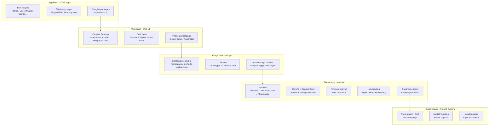

<p align="center">
  
</p>

<h1 align="center">CangHai Desk · Canghai System</h1>

<p align="center">Plug your phone into a display, and it becomes a computer.</p>

<p align="center">
  <a href="./LICENSE"></a>
  
  <a href="https://github.com/cunkai/CangHai-Desk/actions/workflows/build.yml"></a>
</p>

<p align="center">
  English · <a href="./README.md">中文</a>
</p>

---

## What is this?

CangHai Desk (Canghai System) is an open-source Android app. It turns a phone or tablet connected to a display into a computer you can actually work on: the external screen shows a full desktop with windows, a taskbar, a start menu and apps, while the phone screen becomes the remote control for switching displays, installing apps and changing settings. The phone stays a phone; the computer is the bonus.

### Three ways to connect

| Way | How | Best for |
| --- | --- | --- |
| One-cable wired | A single USB-C cable straight to the monitor | Desk work, travel |
| Dock / DeX | Via a dock or the system's desktop mode | A fixed workstation |
| Wireless streaming | Stream the picture to a PC, phone or TV over the Moonlight protocol | No cable, remote use |

> Wired display and external desktop depend on device hardware and system support; streaming needs no cable and works on the local network.

### What's on the external screen

- **Canghai Desktop**: windows you can drag, resize and minimize; a launcher, widgets (clock, weather, to-do) and sticky notes you can place anywhere.
- **13 built-in apps**: office suite, document editor, Markdown, photo editor, music player, calculator, typing practice, drawing board, Huiyin, 2048, Jump, game center and LAN hall — ready out of the box.
- **Keyboard & mouse passthrough**: plug in a keyboard and mouse and work like on a PC; cursor styles are swappable.
- **Its own app ecosystem**: an app is a single HTML file — write one and install it, or pack it as a `.沧海软件` package and share it.

### What's on the phone

The phone shows the control page: pick the native or Canghai desktop per display, change resolution and refresh rate, swap cursor styles, manage installed apps, see the IP address. A red bar at the top lists any missing permission — tap it to grant it, and it disappears once granted.

### Three steps to start

1. Download the APK from [Releases](https://github.com/cunkai/CangHai-Desk/releases) and install it.
2. Open the app and finish authorization (either Root, or root-free Shizuku).
3. Connect a display (cable or streaming) — the desktop lights up on the external screen.

### What you need

- A phone or tablet on Android 8.0+, or HarmonyOS Zhuoyitong (HarmonyOS's Android compatibility environment).
- Root or Shizuku authorization (either one; Root unlocks the most).
- A monitor, TV, or a device that runs a Moonlight client.

> Tested on Snapdragon 8 Gen 2 and Kirin 8020.

### About permissions

- The app does **not** request IME permissions; typing goes through the system keyboard.
- The only accessibility item is an **optional** "pointer overlay service": everything works without it; enabling it shows a unified software pointer above the system bars and improves gamepad navigation. The app never detects, prompts for, or auto-enables it — external keyboard and mouse clicks all go through the Root / Shizuku channel.
- App data lives in a single folder owned by Canghai, and each app can only touch its own share.

---

## Architecture

### Layers



### Bridge layer

The single entry point is `CanghaiCore.invoke(namespace, method, payloadJson)`, returning JSON. On the web side it is wrapped by `CHCore` (`canghai-core.js`); file operations are relayed through the desktop, which identifies the calling app from the message source and never trusts an app-supplied ID.

| Namespace | Purpose | Status |
| --- | --- | --- |
| `fs` | File read/write, directories, app list, storage usage inside the sandbox | Implemented |
| `device` | Device info, download to disk, render scale, streaming & frame-rate status | Implemented |
| `perf` | Performance sampling toggle, state snapshots, reporting | Implemented |
| `lan` | LAN hall (MiniChat, invite-code auth) | Implemented |
| `audio` | Audio capture status | Placeholder, not wired |
| `screen` | Display management | Placeholder, provided directly by the native layer |
| `peripheral` | Peripheral management | Placeholder, provided directly by the native layer |

Apps and the desktop also talk through two descriptive interfaces — descriptions only, no code:

- `window.Canghai(cmd)`: string commands (`min` / `max` / `close` / `frameless` / `debug` …), parsed and executed by the desktop; unknown commands are ignored silently.
- `postMessage` channel: messages tagged `canghai`, dispatched by the desktop; when an app runs standalone in a browser, nobody listens and it's a no-op.

### App model

- One app = one HTML file + an `app.json` manifest + an `icon.svg` icon. The HTML must open directly in a browser without errors, and must not depend on interfaces that only exist inside Canghai.
- `app.json` declares the name, icon, file extensions the app can open (`handles`) and the file entry point (`iface`, e.g. `window.CanghaiOffice.openFile`).
- Install: pick an HTML file, paste code, or import a `.沧海软件` package (a zip holding the HTML, manifest and icon); at install time, hard-coded external references in the HTML are downloaded and inlined into a single file, so it works offline.
- Sandbox: each app can only read and write `<root>/Data/<app id>/`, storing data as JSON files by default (write to a temp file, then atomic rename); path traversal is rejected by the bridge. The app ID is the folder name.
- The manifest is generated by scanning `canghai/apps/`; the desktop opens apps by path.

### Input & display

- External display: system `Presentation` / DeX capabilities plus `DisplayManager` virtual displays — one WebView desktop per screen.
- Peripheral binding: physical keyboards and mice are bound to a specific screen by port; on Android 15+, the public input-association API (`addUniqueIdAssociationByDescriptor`) drops the cursor onto the right virtual display; on older versions, a uinput virtual mouse injected via Root is used.
- Streaming: the bundled Sunshine engine acts as the server (capture, encode, push) and the Moonlight service as the client; the device can push its own picture out or connect to another Sunshine host.
- Input method: the Rime engine (librime) is wired into the native layer, with the keyboard candidate-bar UI still to come; current input goes through the system keyboard.

### Performance scheduling

- The scheduler `governor.js` takes over each app iframe's rAF: 60fps in the foreground, 10fps for other visible windows, paused when minimized or covered; DPR defaults to 1.5 and WebGL antialiasing is off by default; frame rates step down when the desktop struggles and step back up on recovery.
- Apps declare `perf: { fg, bg, dpr }` in `app.json`; when the desktop steps down, it sends a `{ canghai: 'quality' }` message and the app lowers its own quality.
- The rule: do nothing when no rendering is needed, and never draw more pixels than the screen needs.

### Project layout

| Directory | Contents |
| --- | --- |
| `app/src/main/java/com/aosen/shizukudex/` | Native core: Activities, bridge, storage, privileges, input, streaming |
| `app/src/main/java/com/alkaidlab/sunshine/` | Bundled Sunshine streaming engine and controller |
| `app/src/main/assets/phonehome/` | Phone control page (single `index.html`) |
| `app/src/main/assets/canghai/desktop/` | Canghai Desktop (windows, grid, widgets, scheduler) |
| `app/src/main/assets/canghai/dock/` | Dock layer (taskbar, top bar, start menu) |
| `app/src/main/assets/canghai/apps/` | Built-in apps (one folder per app + manifest) |
| `app/src/main/assets/canghai/shared/` | Libraries shared by desktop and apps (three.js runtime, achievements, synth, i18n, …) |
| `app/src/main/jniLibs/` | Prebuilt native libraries (Sunshine, OpenSSL, Rime, uinput) |
| `app/src/main/cpp/` | Native sources (Rime JNI, MiniChat) |
| `tools/` | Debugging and probe scripts |
| `hidden-api-stub/` | Hidden-API stub module |

### Build

```bash
./gradlew assembleDebug      # Debug APK: app/build/outputs/apk/debug/app-debug.apk
./gradlew assembleRelease    # Release APK: app/build/outputs/apk/release/app-release.apk
```

- Requires JDK 17 and Android SDK 34 (`platforms;android-34`, `build-tools;34.0.0`).
- Native `.so` files are prebuilt and committed, so no NDK is needed to build.
- Release signing: place a `key.properties` file at the repo root (`storeFile` / `storePassword` / `keyAlias` / `keyPassword`); without signing config, the release build falls back to the debug signature.
- Pushing a `v*` tag triggers CI (`.github/workflows/build.yml`) to build automatically and publish to [Releases](https://github.com/cunkai/CangHai-Desk/releases).

---

## License

Released under **GPL-3.0** — see [LICENSE](./LICENSE). Issues and pull requests are welcome.

## Acknowledgements

CangHai Desk is built on these excellent open-source projects (in-house modules `aosen_*` / `canghai*` and original code in this repo are not listed):

### Streaming & casting

- **[Sunshine](https://github.com/LizardByte/Sunshine)** — streaming server engine; bundles `com.alkaidlab.sunshine` and its native modules.
- **[Moonlight](https://github.com/moonlight-stream)** / Limelight — streaming protocol and client implementation.
- **[OpenSSL](https://www.openssl.org/)** (`libcrypto` / `libssl`, pulled in by the Sunshine engine) — cryptography and TLS.

### Privileges & system

- **[Shizuku](https://github.com/RikkaApps/Shizuku)** 13.1.5 — root-free privilege bridge.
- **[Rikka Tools Refine](https://github.com/RikkaApps/Refine)** 4.4.0 — hidden-API invocation proxy.
- **[LSPosed HiddenApiBypass](https://github.com/LSPosed/HiddenApiBypass)** 4.3 — bypasses Android's hidden-API restrictions.
- **[Rime / librime](https://github.com/rime/librime)** — input method engine (wired into the native layer; keyboard candidate bar still to come).

### UI & graphics

- **[three.js](https://threejs.org/)** 0.186 — shared 3D runtime (games and live wallpapers).
- **[GSAP](https://gsap.com/)** (with Draggable / InertiaPlugin) — animations for desktop windows and the Dock.
- **[BlurView](https://github.com/Dimezis/BlurView)** 2.0.6 — real-time blur view.

### Documents & data

- **[mammoth.js](https://github.com/mwilliamson/mammoth.js)** — docx import (document app).
- **[docx](https://github.com/dolanmiu/docx)** — docx generation (document app).
- **[marked](https://github.com/markedjs/marked)** — Markdown parsing (Markdown app).
- **[JSZip](https://stuk.github.io/jszip/)**, **[SheetJS](https://sheetjs.com/)**, **[PptxGenJS](https://gitbrent.github.io/pptxgenjs/)** — file import/export in the office suite.

### Language & foundation

- **[Kotlin](https://kotlinlang.org/)** 2.0.21 and **[kotlinx.coroutines](https://github.com/Kotlin/kotlinx.coroutines)** 1.7.3 — language and coroutines.
- **[Gson](https://github.com/google/gson)** 2.10.1 — JSON serialization.
- **[AndroidX AppCompat / Annotation](https://developer.android.com/jetpack/androidx)** — compatibility framework.
