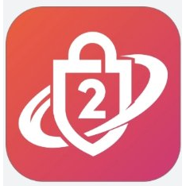
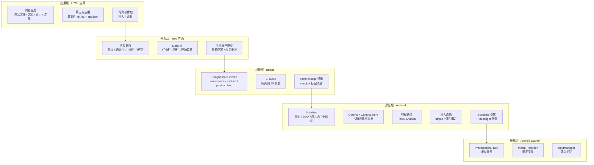

<p align="center">
  
</p>

<h1 align="center">沧海系统 · CangHai Desk</h1>

<p align="center">手机连上显示器，就变成一台电脑。</p>

<p align="center">
  <a href="./LICENSE"></a>
  
  <a href="https://github.com/cunkai/CangHai-Desk/actions/workflows/build.yml"></a>
</p>

<p align="center">
  <a href="./README.en.md">English</a> · 中文
</p>

---

## 这是什么

沧海系统（CangHai Desk）是一个开源的 Android 应用。它让手机或平板连上显示器之后，变成一台可以真正干活的电脑：外屏上是完整的桌面，有窗口、任务栏、开始菜单和各种应用；手机屏幕则变成遥控器，负责切换屏幕、安装应用、调整设置。手机还是手机，电脑是多出来的。

### 三种连屏方式

| 方式 | 怎么连 | 适合 |
| --- | --- | --- |
| 一线通 | 一根 USB-C 线直连显示器 | 桌面办公、出差 |
| 扩展坞 / DeX | 通过扩展坞或系统的桌面模式连接 | 固定工位 |
| 无线串流 | 通过 Moonlight 协议把画面串流到电脑、手机或电视 | 没有线、远程用 |

> 一线通和副屏直显依赖设备硬件与系统支持；串流不挑线，局域网内就能用。

### 外屏上有什么

- **沧海桌面**：窗口可以拖动、缩放、最小化；启动台、小组件（时钟、天气、待办）、便签随手摆。
- **13 款内置应用**：办公套件、文档、Markdown、图片编辑器、音乐播放器、计算器、打字练习、画板、绘音、2048、跳一跳、游戏中心、局域网大厅，开箱即用。
- **键鼠直通**：接上键盘鼠标就能像用电脑一样操作，鼠标样式可以换。
- **自己的应用生态**：一个应用就是一个 HTML 文件，写好就能装，还能打包成「.沧海软件」分享给别人。

### 手机上有什么

手机屏幕显示控制页：给每块屏幕选原生桌面还是沧海桌面、调分辨率和刷新率、换鼠标样式、管理已安装的应用、看 IP 地址。权限缺哪项，顶上红条就显示哪项，点一下去补，补完消失。

### 三步上手

1. 在 [Releases](https://github.com/cunkai/CangHai-Desk/releases) 页面下载 APK 并安装。
2. 连上显示器（插线或串流），外屏亮起桌面，开始用。
3. （可选）想要运行安卓软件、把物理外设绑定到指定屏幕等完整能力，再按提示完成授权（二选一：Root，或免 Root 的 Shizuku）。

### 需要什么

- 一部较新版本的安卓手机或平板，近几年的主流机型都可以；鸿蒙系统可以通过卓易通运行。
- （可选）Root 或 Shizuku 授权（二选一，能力最全的是 Root），用于运行安卓软件等完整能力。
- 显示器、电视，或一台能跑 Moonlight 客户端的设备。

> 已在骁龙 8 Gen 2 与麒麟 8020 平台测试通过。

### 关于权限

- 不用授权也能用：桌面和 HTML 应用不需要任何特权，装上就能跑；授权只影响能不能运行安卓软件、绑定外设等完整能力。
- 应用**不**申请输入法权限，键盘输入走系统原生键盘；也**不**申请无障碍权限。
- 应用数据只放在沧海自己的一个文件夹里，每个应用只能碰自己的那一份。

### 更多作品

 **奥森验证** · 鸿蒙原生 TOTP、2FA 工具 · [华为应用市场](https://appgallery.huawei.com/app/detail?id=com.cunkai.fas)

 **奥森钢琴** · 不用看五线谱，数字简谱钢琴 · [华为应用市场](https://appgallery.huawei.com/app/detail?id=com.cunkai.piano)

---

## 技术架构

### 分层



> 桌面与 HTML 应用不需要特权就能运行；特权通道（Root / Shizuku）只负责运行安卓软件、绑定外设等能力。

### 桥接层

唯一入口是 `CanghaiCore.invoke(namespace, method, payloadJson)`，返回 JSON。网页侧由 `CHCore`（`canghai-core.js`）封装；文件操作经桌面中转，桌面按消息来源识别应用身份，不信任应用自带的 ID。

| 命名空间 | 用途 | 状态 |
| --- | --- | --- |
| `fs` | 沙箱内文件读写、目录、应用清单、存储用量 | 已实现 |
| `device` | 设备信息、下载落盘、渲染缩放、串流与帧率状态 | 已实现 |
| `perf` | 性能采样开关、状态快照、上报 | 已实现 |
| `lan` | 局域网大厅（MiniChat，邀请口令鉴权） | 已实现 |
| `audio` | 音频采集状态 | 占位，未接通 |
| `screen` | 屏幕管理 | 占位，能力由原生层直接提供 |
| `peripheral` | 外设管理 | 占位，能力由原生层直接提供 |

应用与桌面之间另有两套描述性接口——只传描述、不写代码：

- `window.Canghai(cmd)`：字符串命令（`min` / `max` / `close` / `frameless` / `debug` …），桌面解析执行，不认得的忽略不报错。
- `postMessage` 通道：带 `canghai` 标记的消息，桌面收到后分发；应用在浏览器里单独打开时无人监听，是空操作。

### 应用模型

- 一个应用 = 一个 HTML 文件 + `app.json` 清单 + `icon.svg` 图标。HTML 必须能在浏览器里直接打开、不报错，不依赖只有沧海才有的接口。
- `app.json` 声明名字、图标、可打开的文件扩展名（`handles`）与文件入口（`iface`，如 `window.CanghaiOffice.openFile`）。
- 安装：选 HTML 文件、粘贴代码，或导入 `.沧海软件` 包（zip，含 HTML、清单与图标）；安装时把 HTML 里写死的外部引用下载后内联成单文件，离线可用。
- 沙箱：每个应用只能读写 `<根目录>/Data/<应用 ID>/`，默认以 JSON 文件存数据（先写临时文件再原子改名）；路径穿越会被桥接层拒绝。应用 ID 即文件夹名。
- 清单由生成器扫描 `canghai/apps/` 生成，桌面按路径打开应用。

### 输入与显示

- 外屏显示：系统 `Presentation` / DeX 能力 + `DisplayManager` 虚拟显示，一屏一个 WebView 桌面。
- 外设绑定：物理键鼠按端口绑定到指定屏幕；Android 15 起用系统公开的输入关联 API（`addUniqueIdAssociationByDescriptor`）把光标落到正确的虚拟屏上；低版本走 Root 注入的 uinput 虚拟鼠标。
- 画面串流：内置 Sunshine 引擎作服务端（采集、编码、推送），Moonlight 服务作客户端；既可把本机画面推出去，也可连入其它 Sunshine 主机。
- 输入法：Rime 引擎（librime）已接入原生层，键盘候选栏 UI 待接；当前输入走系统原生键盘。

### 性能调度

- 调度器 `governor.js` 接管各应用 iframe 的 rAF：前台 60fps、其它可见窗口 10fps、最小化或被盖住暂停；DPR 默认 1.5，WebGL 默认关闭抗锯齿；桌面帧耗时变差时逐档降帧，恢复后升回。
- 应用在 `app.json` 里声明 `perf: { fg, bg, dpr }`；桌面降档时发 `{ canghai: 'quality' }` 消息，应用自行降画质。
- 原则：不需要渲染时什么都不做，需要渲染时不画超过屏幕需要的像素。

### 目录速览

| 目录 | 内容 |
| --- | --- |
| `app/src/main/java/com/aosen/shizukudex/` | 原生核心：Activities、桥接、存储、特权、输入、串流 |
| `app/src/main/java/com/alkaidlab/sunshine/` | 内置 Sunshine 串流引擎与控制器 |
| `app/src/main/assets/phonehome/` | 手机端控制页（单文件 `index.html`） |
| `app/src/main/assets/canghai/desktop/` | 沧海桌面（窗口、网格、小组件、调度器） |
| `app/src/main/assets/canghai/dock/` | Dock 层（任务栏、顶栏、开始菜单） |
| `app/src/main/assets/canghai/apps/` | 内置应用（每文件夹一个应用 + 清单） |
| `app/src/main/assets/canghai/shared/` | 桌面与应用共用的库（three.js 运行时、成就、音色、国际化等） |
| `app/src/main/jniLibs/` | 预编译原生库（Sunshine、OpenSSL、Rime、uinput） |
| `app/src/main/cpp/` | 原生源码（Rime JNI、MiniChat） |
| `tools/` | 调试与探针脚本 |
| `hidden-api-stub/` | 隐藏 API 存根模块 |

### 构建

```bash
./gradlew assembleDebug      # 调试包：app/build/outputs/apk/debug/app-debug.apk
./gradlew assembleRelease    # 发布包：app/build/outputs/apk/release/app-release.apk
```

- 需要 JDK 17 与 Android SDK 34（`platforms;android-34`、`build-tools;34.0.0`）。
- 原生 `.so` 已预编译提交，构建不需要 NDK。

---

## 开源许可

本项目基于 **GPL-3.0** 发布，详见 [LICENSE](./LICENSE)。欢迎提交 Issue 与 Pull Request。

## 鸣谢

本项目基于以下优秀的开源项目构建（自研模块 `aosen_*` / `canghai*` 与本仓库原创代码不在此列）：

### 串流与投屏

- **[Sunshine](https://github.com/LizardByte/Sunshine)** —— 串流服务端引擎，内置 `com.alkaidlab.sunshine` 及其原生模块。
- **[Moonlight](https://github.com/moonlight-stream)** / Limelight —— 串流协议与客户端实现。
- **[OpenSSL](https://www.openssl.org/)**（`libcrypto` / `libssl`，由 Sunshine 引擎依赖）—— 加密与 TLS。

### 权限与系统

- **[Shizuku](https://github.com/RikkaApps/Shizuku)** 13.1.5 —— 免 Root 的权限桥接。
- **[Rikka Tools Refine](https://github.com/RikkaApps/Refine)** 4.4.0 —— 隐藏 API 调用代理。
- **[LSPosed HiddenApiBypass](https://github.com/LSPosed/HiddenApiBypass)** 4.3 —— 绕过 Android 隐藏 API 限制。
- **[Rime / librime](https://github.com/rime/librime)** —— 输入法引擎（原生层已接入，键盘候选栏待接）。

### 界面与图形

- **[three.js](https://threejs.org/)** 0.186 —— 共享 3D 运行时（游戏与动态壁纸）。
- **[GSAP](https://gsap.com/)**（含 Draggable / InertiaPlugin）—— 桌面窗口与 Dock 的动效。
- **[BlurView](https://github.com/Dimezis/BlurView)** 2.0.6 —— 实时毛玻璃模糊视图。

### 文档与数据

- **[mammoth.js](https://github.com/mwilliamson/mammoth.js)** —— docx 导入（文档应用）。
- **[docx](https://github.com/dolanmiu/docx)** —— docx 生成（文档应用）。
- **[marked](https://github.com/markedjs/marked)** —— Markdown 解析（Markdown 应用）。
- **[JSZip](https://stuk.github.io/jszip/)**、**[SheetJS](https://sheetjs.com/)**、**[PptxGenJS](https://gitbrent.github.io/pptxgenjs/)** —— 办公套件的文件导入导出。

### 语言与基础库

- **[Kotlin](https://kotlinlang.org/)** 2.0.21 与 **[kotlinx.coroutines](https://github.com/Kotlin/kotlinx.coroutines)** 1.7.3 —— 语言与协程。
- **[Gson](https://github.com/google/gson)** 2.10.1 —— JSON 序列化。
- **[AndroidX AppCompat / Annotation](https://developer.android.com/jetpack/androidx)** —— 兼容性框架。
